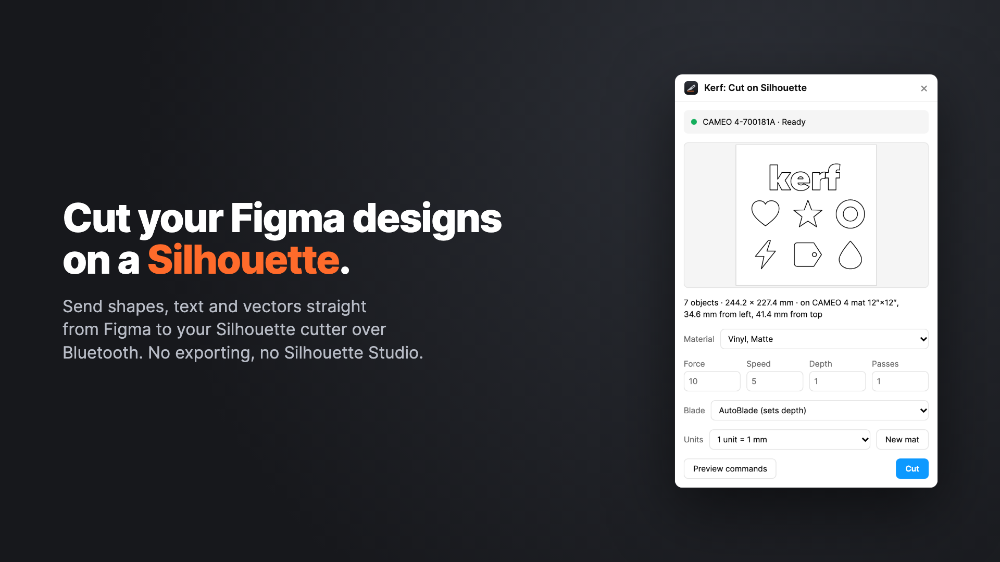

# Kerf

**Cut Figma designs on a Silhouette cutter** over Bluetooth, without Silhouette Studio.



Verified on the **CAMEO 4**. Other Bluetooth models (CAMEO 4 Plus/Pro, CAMEO 5 family, Portrait 3/4, Curio 2) are
detected and use their own cutting width and mat size, but are untested: see [CONTRIBUTING.md](CONTRIBUTING.md) to help.

Kerf is an independent project, not affiliated with Silhouette America or Figma.

## Install

You need two things: the **Figma plugin**, and the **Kerf helper** on your computer. Figma plugins can't use
Bluetooth, so the helper talks to the cutter for them.

### 1. The Kerf helper: pick one

**Mac app (recommended).** [Download Kerf for Silhouette](https://github.com/keoshi/kerf/releases/latest/download/Kerf-for-Silhouette.zip),
unzip it, drag **Kerf for Silhouette** to Applications and open it.

- It lives in the menu bar (blade icon). Allow Bluetooth when macOS asks.
- Turn on **Open at Login** in its menu to have it always ready. It's off by default.
- Signed and notarized by Apple; runs on Apple Silicon and Intel Macs (macOS 13+).

**Or the terminal command**, with no app (macOS, Linux or Windows, with [Node.js](https://nodejs.org) 22.18+):

```sh
npm install -g https://github.com/keoshi/kerf/releases/latest/download/kerf-helper.tgz
kerf
```

Leave `kerf` running while you cut; Ctrl-C stops it. `kerf probe` checks the connection without moving the cutter.
The first run asks for Bluetooth permission for your terminal app. Options:

- `--name "CAMEO 4-700181A"` picks a specific cutter
- `--verbose` logs every reply from the cutter

Use one helper at a time: the app and `kerf` listen on the same port.

### 2. The Figma plugin

**Kerf: Cut on Silhouette** has been submitted to the Figma Community and is in review. Once it's approved, it'll be at
[figma.com/community/plugin/1691487696942320040](https://www.figma.com/community/plugin/1691487696942320040).

Until then, [download the plugin](https://github.com/keoshi/kerf/releases/latest/download/Kerf-Figma-plugin.zip),
unzip it, and in Figma desktop choose **Plugins → Development → Import plugin from manifest…** → `manifest.json`.

### Before cutting

**Quit Silhouette Studio.** The cutter accepts one connection at a time.

The helper connects when the plugin is open and lets go of the cutter about 30 seconds after you close it, so you can
still use Studio in between.

## Using it

1. **New mat** creates a frame the size of your cutter's standard mat (12″×12″ for the Cameo 4).
   Its top-left corner is the mat's top-left corner on the cutter.
   Any top-level frame works as a mat; without one, the selection's top-left becomes the origin.
2. Put shapes, text or vectors inside the frame and select them, or select the frame to cut everything on it.
   - Filled shapes are cut along their outline, holes included.
   - Open vector paths are cut along the path.
   - Text is cut as outlines.
3. Click a shape in the preview to skip it (it turns semi-transparent); click again to include it.
   Each top-level layer counts as one object, e.g. a group or a text layer.
4. Pick a material, or adjust force / speed / depth / passes. Values use Silhouette Studio's scales.
5. **Units** sets how Figma units map to millimetres (default 1 unit = 1 mm).
6. **Preview commands** shows the exact commands for the cutter. **Cut** sends them.

**Stop** halts a running job. The helper stops sending and resets the cutter, which drops whatever it had buffered,
so the cutter is ready for the next job.

Inner shapes are cut before the shapes that contain them. Multiple passes repeat each path back-to-back.

## Contributing

Owners of other Silhouette models can help a lot with a 2-minute read-only probe. See [CONTRIBUTING.md](CONTRIBUTING.md).

Building from source, the local API and releases are covered in [DEVELOPMENT.md](DEVELOPMENT.md).

## Credits

- BLE handshake, write pacing and the seed material presets come from
  [bob-takuya/cameo-cut](https://github.com/bob-takuya/cameo-cut) (MIT).
- Protocol details were cross-checked against
  [fablabnbg/inkscape-silhouette](https://github.com/fablabnbg/inkscape-silhouette) (GPL-2.0, used as a reference only; no code copied).

## Privacy

Kerf runs entirely on your computer: no accounts, analytics or servers. See [PRIVACY.md](PRIVACY.md).

## License

[MIT](LICENSE).
